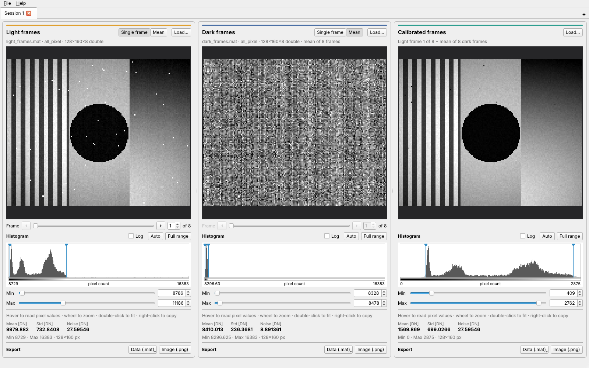

# Image Analyzer Tool

A Qt 6 desktop tool for dark-frame calibration of image stacks stored in MATLAB `.mat` files.

By [AuroralDiffraction](https://github.com/AuroralDiffraction).



Each tab has three panels:

- **Light frames**: drop an X × Y × Z `.mat` file here, then pick which of the Z frames to show (frame 1 by default).
- **Dark frames**: drop the dark stack here. The panel shows the pixel-by-pixel mean over Z (MATLAB: `mean(dark, 3)`).
- **Calibrated frames**: the selected light frame minus the mean dark frame. It updates automatically.

Every panel shows the image's histogram, Min/Max sliders for contrast, and, at the bottom, three values computed with C++ ports of the MATLAB functions in `matlab/`:

- **Mean [DN]** and **Std [DN]**: `calculateImageStats` of the image on display.
- **Noise [DN]**: `calculateImageNoise` (RMS temporal noise) of the whole stack behind the panel: all light frames, all dark frames, or all calibrated frames.

How it is built and why: [docs/ARCHITECTURE.md](docs/ARCHITECTURE.md).

## Building on Windows

### What you need

- **Qt 6.5 or newer** (6.2 is the minimum), installed with the Qt Online Installer from qt.io. In the installer, pick a Qt 6 version and tick **MSVC 2022 64-bit** (needs Visual Studio 2022 or its Build Tools) or **MinGW 64-bit** (self-contained).
- **Qt Creator**, which the installer includes, along with CMake and Ninja.

No other libraries are needed: the MAT-file reader is built in.

### In Qt Creator (easiest)

1. **File → Open File or Project…** and choose `CMakeLists.txt` in this folder.
2. Select a kit, e.g. *Desktop Qt 6.x MSVC2022 64bit*, and click **Configure Project**.
3. **Build** (Ctrl+B), then **Run** (Ctrl+R).

### From the command line

In a *Developer PowerShell for VS 2022* (for MSVC), adjusting the Qt path to your installed version:

```powershell
cmake -S . -B build -G Ninja -DCMAKE_BUILD_TYPE=Release -DCMAKE_PREFIX_PATH=C:/Qt/6.8.0/msvc2022_64
cmake --build build
.\build\ImageAnalyzerTool.exe
```

## Making a standalone .exe to share

The `deploy` target packages the app so it runs on any 64-bit Windows PC, with nothing to install (no Qt, compiler or MATLAB):

1. In Qt Creator, switch to the **Release** build configuration (the computer icon at the bottom left → Build: *Release*). If Release isn't listed, add it under **Projects → Build → Add → Release**.
2. Build the `deploy` target: press **Ctrl+K**, type `cm deploy`, and press Enter. Or, from the command line: `cmake --build <build folder> --target deploy`.
3. The result is in `<build folder>\dist\`:
   - `ImageAnalyzerTool-0.1.0\`: `ImageAnalyzerTool.exe` with the Qt DLLs, plugin folders and (for MinGW) the GCC runtime.
   - `ImageAnalyzerTool-0.1.0.zip`: the same folder, zipped.

Share the zip. The person unzips it anywhere and double-clicks `ImageAnalyzerTool.exe`. The .exe needs the files next to it, so keep the folder together and use a shortcut if you want it on the desktop. Windows may show "Windows protected your PC" for an unsigned app from the internet; click **More info → Run anyway**.

The version number in the folder name comes from `project(... VERSION 0.1.0)` in `CMakeLists.txt`.

### Tests

```powershell
ctest --test-dir build --output-on-failure
```

`tst_core` checks the MAT reader and the processing functions against small files in `tests/data`. `ui_smoke` opens the window off-screen, loads files (including by simulated drag and drop) and checks the calibrated mean. 

The small test files are generated by `python tests/make_fixtures.py` (needs numpy and scipy).

## Using it

| Action | How |
|---|---|
| New tab | **+** at the top right, Ctrl+T, or double-click the empty tab bar |
| Rename / close tab | Double-click the tab or press F2 / click × or press Ctrl+W |
| Load frames | Drag a `.mat` file onto the Light or Dark panel, or click **Load…** (Ctrl+L / Ctrl+D) |
| Choose light frame | ◀ / ▶ buttons (hold to step), slider or spin box (1-based, as in MATLAB) |
| Contrast | **Min** / **Max** sliders, type exact values, or drag the markers in the histogram |
| Quick contrast | **Auto** (0.5–99.5 % percentiles, used by default when a file is loaded) or **Full range** (min to max) |
| Histogram scale | **Log** for a logarithmic count axis |
| Zoom / pan / fit | Mouse wheel / drag / double-click. The three images in a tab zoom and pan together |
| Pixel value | Hover over the image (row and column are 1-based) |
| Copy to clipboard | Right-click: **Copy image**, or **Copy image with histogram and statistics**. The second copies one figure: the image, the histogram exactly as shown in the panel, and Mean / Std / Noise. Both always paste as pictures |
| Export | **Data (.mat)**: raw values of this frame or all frames, with Mean/Std/Noise. **Image (.png)**: the image as displayed, at full resolution. Also in the right-click menu |

### What the exported .mat files contain

| Panel | This frame | All frames |
|---|---|---|
| Light frames | `light_frame`, `frame_index`, `img_mean`, `img_std`, `img_noise`, `source_file` | `light` (the input stack, same class and values), `img_noise`, `source_file` |
| Dark frames | `dark_mean`, `img_mean`, `img_std`, `img_noise`, `dark_frame_count`, `source_file` | – |
| Calibrated frames | `calibrated_frame`, `frame_index`, `img_mean`, `img_std`, `img_noise`, `dark_frame_count`, `light_file`, `dark_file` | `calibrated` (rows × cols × Z double, every `light(:,:,k) − mean(dark,3)`), `img_noise`, `dark_frame_count`, `light_file`, `dark_file` |

`img_mean`, `img_std` and `img_noise` are the values shown in the panel, named after the outputs of the MATLAB functions. Files are saved in MATLAB's default `-v7` format (compressed), so `load('file.mat')` works directly. One variable can be at most 2 GB, as in MATLAB's `-v7`.

From the command line: `ImageAnalyzerTool.exe --light light.mat --dark dark.mat`.

## MAT files

- Any real numeric or logical array of size X × Y or X × Y × Z works, in any numeric type. If a file holds several such arrays, the tool asks which one to use.
- Files saved with MATLAB's default format (`-v7`) or `-v6` are supported.
- Files saved with `-v7.3` are HDF5 files and are not supported yet. Re-save them with `save('file.mat', 'all_pixel', '-v7')`. Note that `-v7` allows up to 2 GB per variable.

## Project layout

```
CMakeLists.txt
src/main.cpp
src/core/    data model and processing (no GUI)
src/io/      MAT-file reader and writer
src/ui/      Qt Widgets user interface
src/app/     Windows resource file (exe icon and version info)
resources/   app icon: SVG artwork, PNGs, .ico, and make_icons.py to regenerate them
matlab/      original MATLAB functions that the C++ code ports
tests/       unit tests, UI smoke test, test-file generator
docs/        architecture notes and screenshot
```

