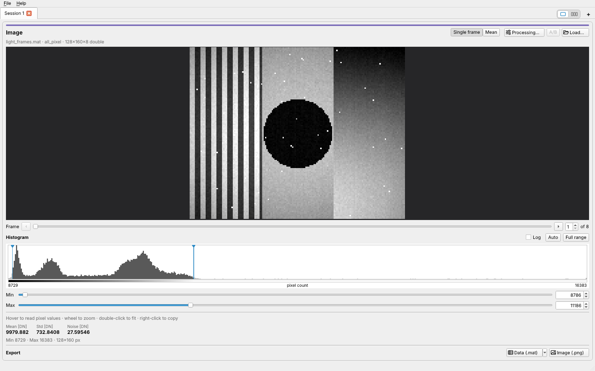
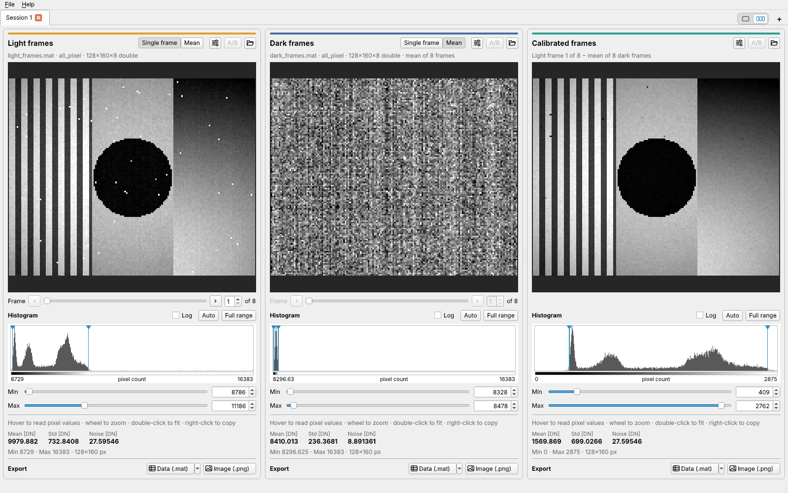
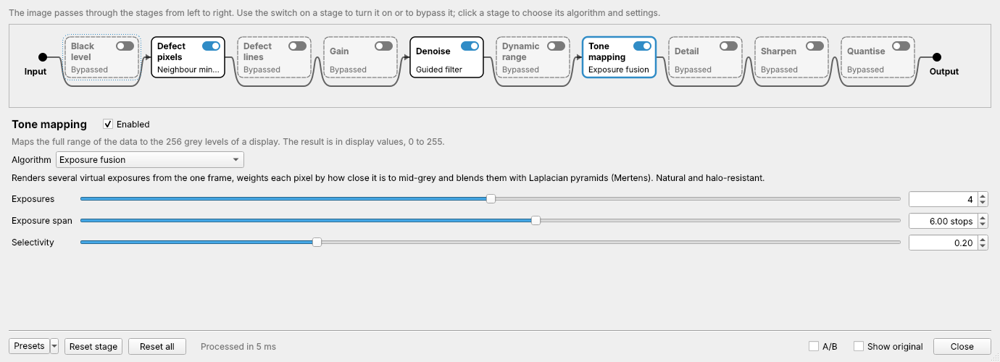
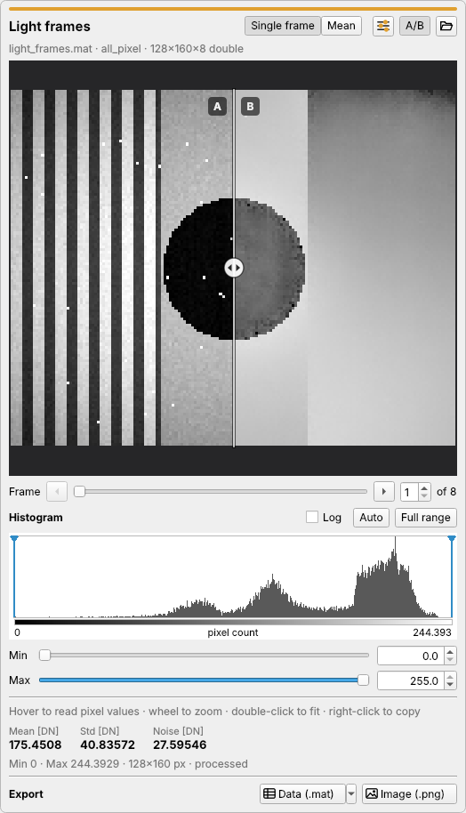
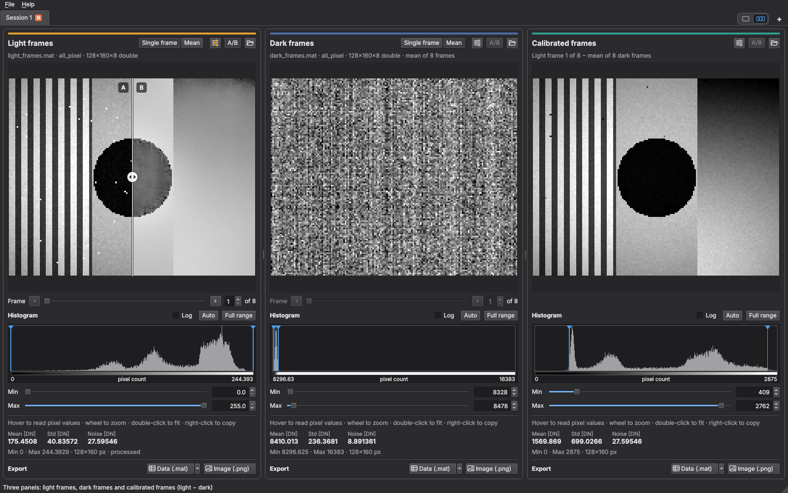

# Image Analyzer Tool

A Qt 6 desktop tool for dark-frame calibration of image stacks stored in MATLAB `.mat` files or in TIFF, PNG and JPEG images, with an image processing pipeline (defect correction, denoising, tone mapping, sharpening) for every panel.

By [AuroralDiffraction](https://github.com/AuroralDiffraction).



A tab shows either a **single image** (the mode the app starts in) or **three panels** for dark-frame calibration. The slide switch next to the tabs, at the top right, changes between the two: the left icon (one panel) is the single image, the right icon (three panels) is light, dark and calibrated frames. Every tab has its own mode.

**Single image**: drop an X × Y or X × Y × Z `.mat` file onto the panel, or one or more TIFF, PNG or JPG images (each file is one frame). The panel has everything a panel of the three-panel mode has: **Single frame** / **Mean**, the frame selector, the histogram with Min/Max contrast, Mean, Std and Noise, and the exports.

The single image is the tab's light stack. Switch to three panels and it is the Light frames, ready for dark frames to be added; switch back and the light frames are shown on their own (dark frames and a loaded calibrated image are kept).



**Three panels**:

- **Light frames**: drop an X × Y × Z `.mat` file here, or one or more TIFF, PNG or JPG images (each file is one X × Y frame). **Single frame** (the default) shows one of the Z frames, chosen with the frame selector (frame 1 at first). **Mean** shows the pixel-by-pixel mean over all frames (MATLAB: `mean(light, 3)`).
- **Dark frames**: the same for the dark stack, but with **Mean** as the default (MATLAB: `mean(dark, 3)`). Switch to **Single frame** to look at, or subtract, one dark frame.
- **Calibrated frames**: the light image on display minus the dark image on display, so `light(:, :, k) − mean(dark, 3)` with the defaults, or `light(:, :, k) − dark(:, :, j)` when both panels show a single frame. It updates automatically. You can also drop a calibrated image from a file here: automatic calibration then turns off, and a red **● Auto calibration off** appears next to the title. Click it to remove the loaded image and turn automatic calibration back on.

Every panel shows the image's histogram, Min/Max sliders for contrast, and, at the bottom, three values computed with C++ ports of the MATLAB functions in `matlab/`:

- **Mean [DN]** and **Std [DN]**: `calculateImageStats` of the image on display.
- **Noise [DN]**: `calculateImageNoise` (RMS temporal noise) of the whole stack behind the panel: all light frames, all dark frames, or all calibrated frames `light(:, :, k) − dark image`. It doesn't change with the frame on display or with Single frame / Mean.

## Image processing

Every panel has a **Processing…** button. It opens that panel's processing pipeline: the stages a camera's image signal processor (ISP) applies to the data of a monochrome sensor, drawn as a chain of nodes from Input to Output.



- **The switch on a node** turns its stage on. A stage that is off is bypassed: the image passes through unchanged, and the wire is drawn around the node. Everything is off at first, so the panel shows the data as loaded.
- **Click a node** to see its settings underneath: the algorithm, a short description of what it does, and its parameters (slider or exact value).
- The panel's image updates while you change things. **A/B** compares before and after on the image itself (see below). **Show original** shows the unprocessed image without losing the settings; **Reset stage** and **Reset all** go back to the defaults; **Presets** has ready-made settings for common situations.

| Stage | Algorithms |
|---|---|
| Black level | Fixed value; automatic (a low percentile of the image) |
| Defect pixels | Neighbour min / max; median threshold. Hot pixels, dead pixels or both |
| Defect rows / columns | Replace defective lines (interpolated from the nearest good lines); remove line offsets (destripe: banding, row / column fixed-pattern noise) |
| Digital gain | Manual; automatic (mean to a target value) |
| Denoise | Bilateral filter; guided filter; non-local means; median filter; Gaussian blur |
| Dynamic range compression | Local (base / detail in log space); global log curve; global gamma curve. The result stays in DN |
| Tone mapping | Percentile stretch; gamma curve; log curve; Reinhard global; plateau equalisation; CLAHE; base / detail split; exposure fusion; bit shift. The result is in display values, 0 to 255 |
| Detail enhancement | Base / detail boost (guided filter, with a noise threshold); multi-scale (fine, medium and coarse bands) |
| Sharpening | Unsharp mask (with a noise threshold and overshoot limit); Laplacian |
| Output quantisation | Round to 8, 6 or 4 bits, with random (TPDF), ordered (Bayer 8 × 8) or Floyd–Steinberg dither. Needs tone mapping |

The stages run in this order. Thresholds and strengths marked "× noise σ" are relative to the pixel noise estimated from the image, so the defaults suit 8-bit and 16-bit data alike. Which tone mapping to start with:

| Situation | Start with | Why |
|---|---|---|
| Ordinary scene, moderate range | Gamma curve | Monotonic and predictable; brightness order is preserved |
| Bright and dark regions in one frame | Exposure fusion or base / detail split | They compress large-scale contrast and leave texture alone |
| Narrow histogram on a pedestal (thermal) | Plateau equalisation | Output codes follow the pixel population; the plateau stops big flat areas from taking all of them |
| Inspection, where visibility beats appearance | CLAHE | The most local contrast everywhere; keep the clip limit low to control grain |
| Values must stay comparable across the frame | Any global curve | One input value always gives one output value |
| Smooth gradients show bands | Output quantisation with dither | Trades contouring for fine noise, which the eye tolerates far better |

### A/B: before and after



The **A/B** button next to **Processing…** (also a checkbox in the pipeline window) puts a divider on the panel's image while processing is on. Left of the divider is the unprocessed image (**A**), right of it the processed one (**B**). Drag the divider across the image; double-click it to put it back in the middle. Zooming and panning work as usual, and the divider stays on the visible part of the image.

The A side is shown with the panel's Min/Max range when the processed values are on the same scale (for example denoising or defect correction only). After tone mapping, gain or black level the scales differ, so the A side gets the automatic stretch it would have on its own. The divider is only on screen: copies and exports hold the processed image.

What processing changes, and what it leaves alone:

- While a stage is on, the panel shows the processed image, and the **histogram, Min/Max contrast, Mean and Std describe the processed image** (the line below them ends in "processed"). After tone mapping these are display values from 0 to 255, and the image is shown from 0 to 255.
- Hovering shows the processed value and the unprocessed one.
- **Noise** is still the temporal noise of the unprocessed frames.
- Every panel has its own pipeline, applied to its own image on display. The **calibrated image is always calculated from the unprocessed light and dark images**; to process the result, use the Calibrated panel's own pipeline.
- **Data (.mat) → Image on display** saves the processed image, with a text variable `processing` that lists the stages (e.g. `Denoise: Bilateral filter; Tone mapping: CLAHE`). **All frames** saves the unprocessed stack. **Image (.png)** and the clipboard copies show the image as displayed.
- Not a number (NaN) and infinite pixels are left as they are.

## Language

The interface is in Chinese (简体中文) by default, and can be switched to English: **文件 → 设置…** (**File → Settings…**, Ctrl+,), choose the language under **语言 / Language** and confirm. The new language is used after the app restarts; the dialog offers to restart it straight away (images that are loaded are not kept). The choice is remembered.

The screenshots and the names used in this README are from the English interface.

## Appearance

**File → Settings…** also has the theme, under **主题 / Theme**: **Follow the system** (the default), **Light** or **Dark**. It changes as soon as you click OK, without a restart, and the choice is remembered.



On Windows the app uses Qt's Windows 11 style (rounded controls, light and dark) when the Qt it was built with has it. What you get depends on that Qt version:

| Built with | Windows 11 | Windows 10 |
|---|---|---|
| Qt 6.8.1 or newer | Windows 11 style, light or dark | Windows 11 style, light or dark |
| Qt 6.7 – 6.8.0 | Windows 11 style | Classic Windows style when light, Fusion style when dark |
| Qt 6.2 – 6.6 | Classic Windows style when light, Fusion style when dark | The same |

With Qt older than 6.8, **Light** and **Dark** use Qt's Fusion style with the app's own colours, and the window's title bar keeps the system's colour. Figures copied to the clipboard are always drawn on white.

How it is built and why: [docs/ARCHITECTURE.md](docs/ARCHITECTURE.md).

## Building on Windows

### What you need

- **Qt 6.8.1 or newer** is recommended: with it the app has the Windows 11 look on Windows 10 and 11, and Qt switches between light and dark colours itself. Older versions down to 6.2 still build (see [Appearance](#appearance) for what you get). Qt is installed with the Qt Online Installer from qt.io. In the installer, pick a Qt 6 version and tick **MSVC 2022 64-bit** (needs Visual Studio 2022 or its Build Tools) or **MinGW 64-bit** (self-contained).
- **Qt Creator**, which the installer includes, along with CMake and Ninja.

No other libraries are needed: the MAT-file and TIFF readers are built in, and PNG and JPEG support comes with Qt. The Chinese translation is compiled with Qt's `lrelease`, which is part of a standard Qt installation.

### In Qt Creator (easiest)

1. **File → Open File or Project…** and choose `CMakeLists.txt` in this folder.
2. Select a kit, e.g. *Desktop Qt 6.x MSVC2022 64bit*, and click **Configure Project**.
3. **Build** (Ctrl+B), then **Run** (Ctrl+R).

### From the command line

In a *Developer PowerShell for VS 2022* (for MSVC), adjusting the Qt path to your installed version:

```powershell
cmake -S . -B build -G Ninja -DCMAKE_BUILD_TYPE=Release -DCMAKE_PREFIX_PATH=C:/Qt/6.8.0/msvc2022_64
cmake --build build
.\build\ImageAnalyzerTool.exe
```

## Making a standalone .exe to share

The `deploy` target packages the app so it runs on any 64-bit Windows PC, with nothing to install (no Qt, compiler or MATLAB):

1. In Qt Creator, switch to the **Release** build configuration (the computer icon at the bottom left → Build: *Release*). If Release isn't listed, add it under **Projects → Build → Add → Release**.
2. Build the `deploy` target: press **Ctrl+K**, type `cm deploy`, and press Enter. Or, from the command line: `cmake --build <build folder> --target deploy`.
3. The result is in `<build folder>\dist\`:
   - `ImageAnalyzerTool-0.4.0\`: `ImageAnalyzerTool.exe` with the Qt DLLs, plugin folders and (for MinGW) the GCC runtime.
   - `ImageAnalyzerTool-0.4.0.zip`: the same folder, zipped.

Share the zip. The person unzips it anywhere and double-clicks `ImageAnalyzerTool.exe`. The .exe needs the files next to it, so keep the folder together and use a shortcut if you want it on the desktop. Windows may show "Windows protected your PC" for an unsigned app from the internet; click **More info → Run anyway**.

The version number in the folder name comes from `project(... VERSION 0.4.0)` in `CMakeLists.txt`. What changed in each version: [CHANGELOG.md](CHANGELOG.md).

### Tests

```powershell
ctest --test-dir build --output-on-failure
```

GitHub Actions runs them on every push (see [Releases and automatic builds](#releases-and-automatic-builds-github-actions)).

`tst_core` checks the MAT, TIFF, PNG and JPEG readers and the processing functions against small files in `tests/data`, and the example data in `examples/` against values computed with NumPy. `tst_isp` checks every stage and algorithm of the image processing pipeline on small synthetic images (defects are repaired and nothing else is touched, noise goes down while edges stay, every tone mapping stays within 0–255, dither keeps the local average, …). `ui_smoke` opens the window off-screen, checks single image mode and the switch to three panels (and that every tab keeps its own mode), loads files (including several image files at once, by simulated drag and drop), switches between Single frame and Mean, loads a calibrated image from a file and turns automatic calibration back on, opens a panel's image processing pipeline and switches stages on and off, and checks the results and the exports.

The small test files are generated by `python tests/make_fixtures.py` (needs numpy and scipy; the image files also need tifffile, imagecodecs and Pillow). The example data is generated by `python examples/make_examples.py` (needs numpy, tifffile and Pillow).

## Releases and automatic builds (GitHub Actions)

- **Build** (`.github/workflows/cmake-single-platform.yml`) runs on every push and pull request: it builds the app with MSVC, runs the tests, and packages it. The zip is attached to the run as the artifact `ImageAnalyzerTool-<version>.zip`. If a test fails, the run also keeps the full test log (artifact `test-log`).
- **Release** (`.github/workflows/release.yml`) publishes a GitHub release whenever the version in `CMakeLists.txt` has no release yet. To make one:
  1. Change `project(... VERSION 0.4.0)` in `CMakeLists.txt` to the new version, e.g. `0.5.0`.
  2. Add a `## 0.5.0` section at the top of `CHANGELOG.md`. It becomes the release notes.
  3. Push to `main`.

  The workflow builds and tests that commit, then creates the release `v0.5.0` (and its tag) with `ImageAnalyzerTool-0.5.0-windows-x64.zip`. Pushes that don't change the version stop after the version check. To retry a failed release, open **Actions → Release → Run workflow** on `main`.

The package includes the Visual C++ runtime DLLs, so it also runs on PCs that don't have the Visual C++ Redistributable installed.

## Using it

| Action | How |
|---|---|
| New tab | **+** at the top right, Ctrl+T, or double-click the empty tab bar |
| Rename / close tab | Double-click the tab or press F2 / click × or press Ctrl+W |
| Interface language | **File → Settings…** (文件 → 设置…): Chinese or English, used after a restart |
| Light or dark theme | **File → Settings…** → **主题 / Theme**: Follow the system, Light or Dark. Applies at once |
| Single image or three panels | The slide switch at the top right, next to **+**: click the one-panel or the three-panel icon. It applies to the tab on display; new tabs start with a single image |
| Load an image (single image) | Drag a `.mat` file, or one or more TIFF / PNG / JPG images, onto the panel, or click **Load…** (Ctrl+L) and select one or more files |
| Load frames (three panels) | Drag a `.mat` file, or one or more TIFF / PNG / JPG images, onto the Light or Dark panel, or click **Load…** (Ctrl+L / Ctrl+D) and select one or more files |
| One frame or the mean | **Single frame** / **Mean** at the top of the panel (Light and Dark panels in three-panel mode) |
| Choose a frame | ◀ / ▶ buttons (hold to step), slider or spin box (1-based, as in MATLAB), in Single frame mode |
| Calibrated image from a file | Drag one file onto the Calibrated panel, or click **Load…** there (or **File → Open calibrated image…**). Click the red **● Auto calibration off** to go back to light − dark |
| Contrast | **Min** / **Max** sliders, type exact values, or drag the markers in the histogram |
| Quick contrast | **Auto** (0.5–99.5 % percentiles, used by default when a file is loaded) or **Full range** (min to max) |
| Histogram scale | **Log** for a logarithmic count axis |
| Zoom / pan / fit | Mouse wheel / drag / double-click. The three images in a tab zoom and pan together |
| Pixel value | Hover over the image (row and column are 1-based) |
| Image processing | **Processing…** at the top of a panel (or right-click → **Image processing…**): turn stages on with their switches, click a stage for its algorithm and settings. See [Image processing](#image-processing) |
| Before / after | **A/B** at the top of a panel, while processing is on: drag the divider across the image (unprocessed left, processed right) |
| Copy to clipboard | Right-click: **Copy image**, or **Copy image with histogram and statistics**. The second copies one figure: the image, the histogram exactly as shown in the panel, and Mean / Std / Noise. Both always paste as pictures |
| Export | **Data (.mat)**: raw values of the image on display (the processed image while image processing is on), with Mean/Std/Noise, or all frames of the stack. **Image (.png)**: the image as displayed, at full resolution. Also in the right-click menu |

### What the exported .mat files contain

| Panel | Image on display | All frames |
|---|---|---|
| Image (single image mode) | Single frame: `frame`, `frame_index`. Mean: `mean_frame`, `frame_count`. Both: `img_mean`, `img_std`, `img_noise`, `source_file` | `frames` (the input stack, same class and values), `img_noise`, `source_file` |
| Light frames | Single frame: `light_frame`, `frame_index`. Mean: `light_mean`, `light_frame_count`. Both: `img_mean`, `img_std`, `img_noise`, `source_file` | `light` (the input stack, same class and values), `img_noise`, `source_file` |
| Dark frames | Mean: `dark_mean`. Single frame: `dark_frame`, `frame_index`. Both: `img_mean`, `img_std`, `img_noise`, `dark_frame_count`, `source_file` | `dark` (the input stack, same class and values), `img_noise`, `dark_frame_count`, `source_file` |
| Calibrated frames | `calibrated_frame`, `calibration` (how it was calculated, e.g. `light(:, :, 2) - mean(dark, 3)`), `frame_index` (light Single frame) or `light_frame_count` (light Mean), `dark_frame_index` (dark Single frame), `img_mean`, `img_std`, `img_noise`, `dark_frame_count`, `light_file`, `dark_file` | `calibrated` (rows × cols × Z double: every `light(:,:,k)` minus the dark image on display), `calibration`, `dark_frame_index` (dark Single frame), `img_noise`, `dark_frame_count`, `light_file`, `dark_file` |
| Calibrated frames, loaded from a file | `calibrated_frame`, `frame_index` (stacks only), `img_mean`, `img_std`, `img_noise`, `source_file` | `calibrated` (the loaded stack, same class and values), `img_noise`, `source_file` |

`img_mean`, `img_std` and `img_noise` are the values shown in the panel, named after the outputs of the MATLAB functions. While image processing is on for the panel, the "Image on display" file holds the processed image under the same name, its `img_mean` and `img_std`, and a text `processing` with the stages that were applied; "All frames" always holds unprocessed data. `source_file`, `light_file` and `dark_file` hold full paths, one per line when the frames came from several image files (`splitlines(source_file)` in MATLAB). Files are saved in MATLAB's default `-v7` format (compressed), so `load('file.mat')` works directly. One variable can be at most 2 GB, as in MATLAB's `-v7`.

From the command line: `ImageAnalyzerTool.exe --light image.mat` opens a single image, and `ImageAnalyzerTool.exe --light light.mat --dark dark.mat` opens the three panels. Repeat `--light` or `--dark` to load several images (`--light a.tif --light b.tif`), and add `--calibrated file` to show a calibrated image from a file.

## MAT files

- Any real numeric or logical array of size X × Y or X × Y × Z works, in any numeric type. If a file holds several such arrays, the tool asks which one to use.
- Files saved with MATLAB's default format (`-v7`) or `-v6` are supported.
- Files saved with `-v7.3` are HDF5 files and are not supported yet. Re-save them with `save('file.mat', 'all_pixel', '-v7')`. Note that `-v7` allows up to 2 GB per variable.
- Load one `.mat` file at a time: combining several files into one stack works for images only.

## Image files (TIFF, PNG, JPEG)

- Each file is one X × Y frame (rows × columns, as MATLAB's `imread` returns it). Drop several files onto the Light or Dark panel to make a stack: they become frames 1, 2, 3, … in natural file-name order (`frame_2.png` before `frame_10.png`), and must all have the same size. The Calibrated panel takes one file.
- Values are used as stored, in their own type, as `imread` does: 8-bit images become uint8, 16-bit uint16, 32-bit float TIFFs single, and so on. Files of different types in one stack are converted to double.
- Grey images saved as RGB (equal red, green and blue) keep their values. Colour images are converted to grey with MATLAB's `rgb2gray` weights (0.2989 R + 0.5870 G + 0.1140 B), as double; the status bar and the tooltip of the panel's file line say so. Alpha channels are ignored.
- TIFF: 8-, 16-, 32- and 64-bit integer and 32- and 64-bit floating-point samples, greyscale or RGB, and 1-bit images; uncompressed, LZW, Deflate (ZIP) or PackBits, with or without a predictor; strips or tiles; BigTIFF. Only the first page of a multi-page TIFF is read. JPEG-compressed TIFFs and palette (indexed colour) images are not supported.
- JPEG is 8-bit and lossy: fine for a quick look, but not for noise measurements.

## Example data

`examples/` holds simulated light and dark frames from a 14-bit sensor, 128 × 160 pixels × 8 frames, in every supported format: `light_frames.mat` and `dark_frames.mat` (variable `all_pixel`), the same frames as one file per frame in `light_tiff/`, `dark_tiff/`, `light_png/`, `dark_png/`, `light_jpg/` and `dark_jpg/`, and `calibrated_frame01.tif` to try loading an image into the Calibrated panel. `reference.json` holds the expected results, computed with NumPy, which `tst_core` checks.

To try it, drop `light_frames.mat` onto the panel; then switch to three panels and drop `dark_frames.mat` onto Dark frames. Or select all files in `light_tiff/` and drop them together. `python examples/make_examples.py --rows 1028 --cols 1408 --frames 20 --out <folder>` writes a larger set; `examples/make_examples.py` explains what is simulated.
## Translations

The texts in the code are English; `translations/ImageAnalyzerTool_zh_CN.ts` holds the Chinese ones. The build compiles it and embeds it in the .exe, so there is no extra file to ship.

After adding or changing texts in the code (inside `tr(...)` or `QCoreApplication::translate(...)`):

1. `cmake --build <build folder> --target update_translations` adds the new texts to the `.ts` file and keeps the existing translations.
2. Translate the new entries in Qt Linguist (`linguist translations/ImageAnalyzerTool_zh_CN.ts`), or edit the file by hand: fill in `<translation>` and remove `type="unfinished"`.
3. Build again. A text without a translation is shown in English.

To add another language, add its `.ts` file to `IAT_TS_FILES` in `CMakeLists.txt` and its code and name to `languages()` in `src/ui/Language.cpp`.

## Project layout

```
CMakeLists.txt
src/main.cpp
src/core/    data model, processing and the image processing pipeline (no GUI)
src/io/      MAT-file reader and writer, TIFF / PNG / JPEG readers
src/ui/      Qt Widgets user interface
src/app/     Windows resource file (exe icon and version info)
translations/  interface translations (Chinese)
resources/   app icon: SVG artwork, PNGs, .ico, and make_icons.py to regenerate them
matlab/      original MATLAB functions that the C++ code ports
tests/       unit tests, UI smoke test, test-file generator
.github/     GitHub Actions: build and test on every push, releases
examples/    simulated example data and the script that makes it
docs/        architecture notes and screenshots
```

